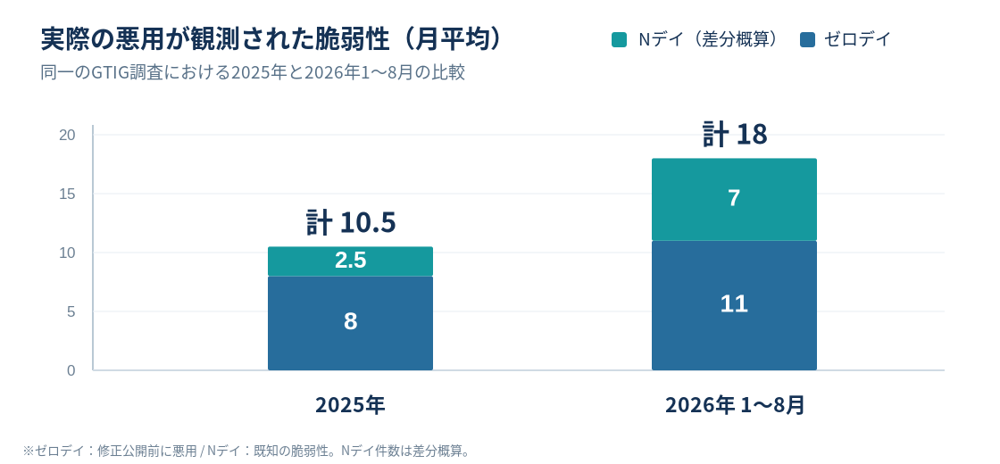
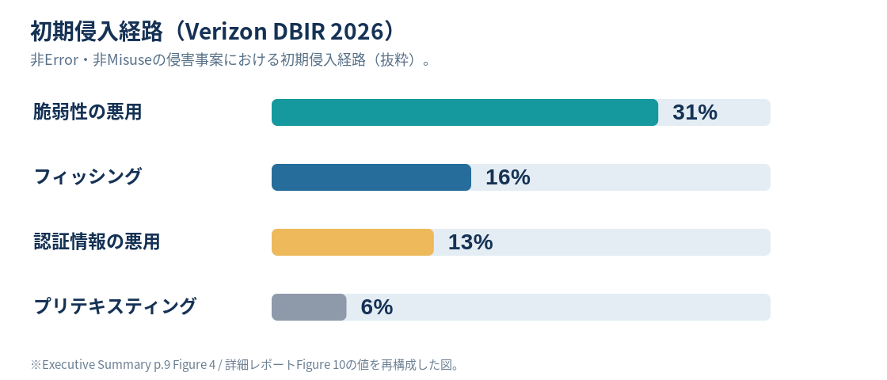
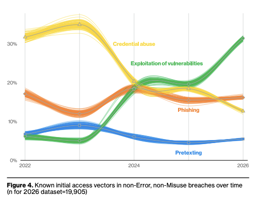

## 統計値パート

### ゼロデイとNデイ

| | ゼロデイ（Zero-day） | Nデイ（N-day） |
|---|---|---|
| 意味 | 修正提供前に実際に悪用される脆弱性 | 既に公表・認知された脆弱性 |
| 難しさ | 事前把握・事前修正が難しい | 公開情報・PoCが攻撃にも使われる |
| 防御の重点 | 多層防御、検知、隔離・封じ込め | リスクに応じた即時対処、暫定遮断 |
| 共通の備え | **検知・対応・復旧を機能させる** | **検知・対応・復旧を機能させる** |

**Nデイ＝必ずパッチが存在する、ではない。** 公表後も修正が未提供の場合がある。

出典：用語・集計上の定義は [Google GTIG「2025 Zero-Days in Review」](https://cloud.google.com/blog/topics/threat-intelligence/2025-zero-day-review) を参考に整理

### ゼロデイ／Nデイの悪用推移

出典：[GTIG「Vulnerability Discovery and Exploitation Trends in the AI Era」（2026年9月30日）](https://cloud.google.com/blog/topics/threat-intelligence/vulnerability-discovery-and-exploitation-trends-in-the-ai-era)｜[原資料のFigure 4](https://storage.googleapis.com/gweb-cloudblog-publish/images/Figure_5_Count_of_all_vulnerabilities_expl.max-1200x1200.png)。
Nデイは月平均値の差分概算。2026年1〜8月に悪用が観測された脆弱性の62％はゼロデイ。AIが増加の唯一の原因とは限らない。

### 侵害事案の初期侵入経路

出典：[Verizon「2026 DBIR Executive Summary」p.9 Figure 4](https://www.verizon.com/business/resources/executivebriefs/2026-dbir-executive-summary.pdf#page=9)｜原図を数値ベースで再構成。n=19,905（非Error・非Misuseのデータ侵害事案）。脆弱性悪用31％はゼロデイとNデイを含み、全攻撃・全侵入の割合ではない。

## 結論パート

### 数字が示している3つの事実

1. **脆弱性の悪用は、実際の侵入における主要経路の一つである。**
2. **攻撃が短時間で進む事例があり、対処の猶予を前提にはできない。**
3. **以前から対処すべきとされてきた課題が、今なお残っている。**

> 既知のものを迅速に閉じる。未知のものによる侵入も想定し、早く発見して被害を封じ込める。

